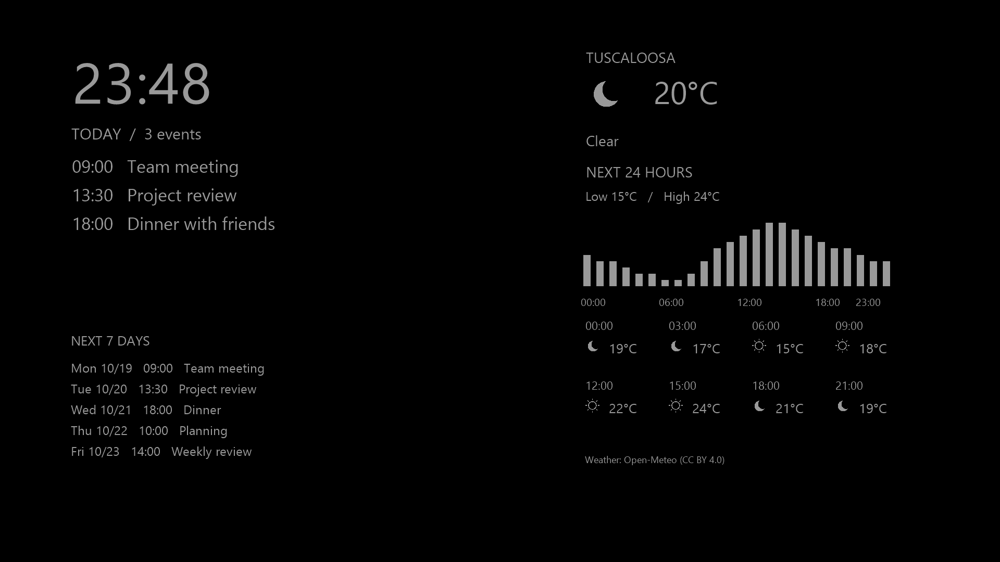

# Sleep Clock for Roku

Two minimal, sleep-friendly Roku screensavers are included.



Preview uses sample data and brighter text for readability. The actual screensaver uses dim gray text on pure black.

## Build from source

On Windows, run `./package-all.ps1` in PowerShell. The script generates menu artwork, creates a blank ignored `outlook-screensaver/source/config.brs` from the example if needed, and builds both ZIP packages in `dist`.

To validate the BrightScript logic, install Node.js and run:

```sh
npm install
npm test
npm run check
```

For a local developer checkout using a different package manager, the same `test` and `check` scripts are available from `package.json`.

## Versions

### Sleep Clock

- Pure black background
- Large 24-hour local time
- Dim gray text (`#181818`) on an explicitly opaque black background (`#000000`)
- Moves every 10 minutes to reduce OLED image retention
- No network access, ads, or sound

Package: `dist/night-clock-roku.zip`

### Sleep Clock + Agenda

- Displays the same large clock
- Clock remains visible at all hours; agenda/weather alternate with Kagi News and Telegram pages
- From 23:00 through 06:59, all text, charts and weather icons use an extra-dim palette (approximately `#0C0C0C`)
- From 07:00 to 22:59, the palette increases to `#242424`
- Automatically adjusts at the time boundary using the Roku device's local timezone; data continues refreshing every 5 minutes
- Displays events overlapping the rolling next 7 days, sorted by start time and labeled with weekday, date and local time
- Gives TODAY a dedicated 330-pixel-tall area with 34-point event text (38 on sparse days), above a compact 24-point weekly agenda
- Pages TODAY independently in groups of three events and the weekly agenda in groups of six, every 20 seconds; the layout stays fixed
- Refreshes the calendar every 5 minutes while the screensaver is running
- Keeps the clock and agenda in a fixed position
- Displays current temperature plus the next 24 hourly Celsius forecasts for Tuscaloosa, AL 35406
- Shows 24 hourly temperature bars, the forecast low/high and 8 three-hourly temperature/icon samples
- Requests calendar and weather updates every 5 minutes while running
- Uses a private, read-only Outlook ICS link

#### Kagi News rotation

The cycle is **agenda and weather (2 minutes) > news story 1 (1 minute) > Telegram message/article > agenda and weather (2 minutes) > news story 2 (1 minute) > next Telegram message/article**. Every continuation page of a Telegram message/article is shown consecutively before returning to the agenda. The clock stays visible and the existing day/night palette applies to every page. Data refreshes do not reset the rotation timer.

News comes only from Kagi's public English Technology (`tech.json`), Science (`science.json`) and Economy (`economy.json`) feeds. Up to three stories per category are interleaved by topic, avoiding repeated headlines or source articles. General World and Politics feeds are not requested. A small headline-keyword heuristic lowers the priority of politics-heavy stories within the selected categories; it is best-effort preference matching, not a guarantee that economic or technical coverage will never mention politics.

Each page contains a headline, a shortened English AI-generated summary, the feed's edition date and an original publisher link. No images, videos or user interaction are used. Network requests and JSON parsing run in a Task independently of Outlook, weather and Telegram. The app checks for updates every five minutes; [Kagi publishes daily editions around noon UTC](https://help.kagi.com/kagi/news/index.html), so polling does not imply new stories every five minutes. Failed categories reuse their last cached stories, with a delayed-data notice and their original edition date. Without usable news, that interval is skipped.

Only public news metadata is stored in the Roku registry. No Outlook information is sent to Kagi. [Kagi's data license](https://github.com/kagisearch/kite-public#install--run-kagi-news-front-end) is [CC BY-NC 4.0](https://creativecommons.org/licenses/by-nc/4.0/): attribution and non-commercial use only. This personal screensaver credits Kagi News on each page and notes that summaries are AI-generated and shortened. Verify important reporting at the linked publisher. The app source's availability does not relicense Kagi's data for commercial use.

`dist/previews/news-page-readable.png`, `news-page-day.png` and `news-page-night.png` use original layout-demo copy, not live reporting. The readable preview is intentionally brighter than the TV palette.

For an optional live parser check, download the three feed files to `.tools/kagi-tech.json`, `.tools/kagi-science.json` and `.tools/kagi-economy.json`, then run:

```sh
node .tools/node_modules/brs/bin/cli.js outlook-screensaver/components/SharedContent.brs outlook-screensaver/components/NewsContent.brs tests/news-live-tests.brs
```

#### Telegram channel

Font registration, text measurement and pagination run only inside the Telegram Task worker. The render thread starts the clock immediately and consumes completed page data; it does not create `roFontRegistry` or perform long text layout. If font metrics are unavailable, the worker uses conservative widths rather than dereferencing an invalid component. `npm test` includes a render-thread startup guard because desktop BrightScript interpreters do not enforce all Roku thread restrictions.

The screensaver reads the public preview of [@DNSPODT](https://t.me/s/DNSPODT), independently of Outlook and Kagi News, at startup and every five minutes. No Telegram account, phone number, login code or bot token is used. This is a public feed reader; it does not join the channel on your account. The public HTML preview is not a stable API and may stop working if Telegram changes its markup or restricts access. Private channels are not supported.

The latest six posts with visible text or captions are considered. Only each post's own `js-message_text` body is selected: Telegram reply previews (`js-message_reply_text`) are excluded, while blockquotes that belong to the actual post are retained. Exactly one message or article owns each full-width page, with a larger 30px body font, explicit page numbers and a reading countdown. Long messages continue across as many consecutive pages as needed; the next message waits until the next Telegram visit. No inserted ellipses or text truncation are used. The worker pre-wraps lines, and the render thread draws those exact lines without a second wrapping pass. Conservative CJK line-height and width headroom protect the final lines from clipping.

When a post ends with the English word `Source` (ignoring case and trailing punctuation), its caption is replaced by its linked public Telegraph article's complete text and title. The reader uses the public [Telegraph getPage API](https://telegra.ph/api#getPage), preserving paragraphs and visible captions but excluding embedded images, video and frames. Only validated `https://telegra.ph/` article paths are supported; arbitrary websites, paywalls and verification pages are not bypassed. Source posts without a readable supported article are skipped, never presented as caption-only articles. Successful articles are cached in memory for one hour; a failed refresh can reuse that cached article with a delayed-data notice. No account or API token is required.

Reading time is computed separately for each page: ordinary messages receive 60-150 seconds, and article pages receive 90-180 seconds, depending on CJK character and Latin word counts. All continuation pages finish before returning to the two-minute agenda. Updates are held until the current collection's pages finish, so no refresh interrupts a long message. Reading the collection again then uses the latest downloaded posts. Message/article text stays in its original language; interface labels remain English. Media-only posts, photos, videos, reactions and avatars are not displayed. Message timestamps use the Roku local timezone, and source post links are shown as text, not interactive controls.

Telegram posts are kept only in memory. Failed downloads retain the last usable collection with an `Update delayed` notice on its next display; without usable posts, the Telegram interval is skipped. If news is unavailable but Telegram is usable, Telegram can still follow the agenda. The bundled Noto Sans SC font supplies Chinese glyphs; unsupported glyphs such as some emoji use blank fallback. See `outlook-screensaver/fonts` for the font's source, hash and license. No Outlook information is sent to Telegram, and no live message content is committed to Git.

For an optional live parser check, download `https://t.me/s/DNSPODT` to `.tools/telegram-feed.html`, then run:

```sh
node .tools/node_modules/brs/bin/cli.js outlook-screensaver/components/SharedContent.brs outlook-screensaver/components/TelegramContent.brs tests/telegram-live-tests.brs
```

`node scripts/telegram-reader-fixtures.cjs` optionally downloads public Telegram and Telegraph fixtures into ignored `.tools` files, checks that every message/article character survives pagination, and exports preview page data using the production BrightScript reader. `./generate-telegram-preview.ps1 -Page 1 -RefreshFixtures` generates a readable live-message/article layout preview in `dist/previews`; select subsequent pages with `-Page 2`, or use `-NightPalette` to inspect the actual nighttime color. The preview uses conservative fallback metrics and a Windows CJK font for simulation, not a Roku capture. Neither the normal test suite nor the package build downloads or commits live posts or article bodies.

Package: `dist/night-clock-outlook-roku.zip`

Weather data comes from [Open-Meteo](https://open-meteo.com/) under [CC BY 4.0](https://creativecommons.org/licenses/by/4.0/). Weather uses an approximate ZIP-area centroid (33.3388, -87.4676). Current conditions are model estimates; polling every 5 minutes does not mean the provider issues new model data every 5 minutes. Weather and calendar load independently. If a weather update fails, the last successful temperature remains visible with a delayed-data message.

Calendar recurrence support includes common daily, weekly, monthly and yearly rules, intervals, COUNT/UNTIL, BYDAY/BYMONTH/BYMONTHDAY, EXDATE/RDATE and RECURRENCE-ID overrides/cancellations. Embedded Outlook VTIMEZONE rules are used for source event times; display times follow the Roku device timezone. Advanced rules such as BYSETPOS, negative BYMONTHDAY, sub-day recurrence and THISANDFUTURE overrides are not supported. Recurrence expansion is bounded at 40,000 days for COUNT series. All-day events use local midnight boundaries. Set the Roku timezone correctly before testing.

## Logic validation

Developer tools can be installed under the ignored `.tools` directory. Run `node .tools/node_modules/brs/bin/cli.js outlook-screensaver/components/DisplaySchedule.brs outlook-screensaver/components/CalendarParser.brs outlook-screensaver/components/WeatherTask.brs tests/logic-tests.brs` for day/night brightness boundaries, calendar-window, recurrence, exception, timezone and 24-hour forecast tests. A successful run ends with `TEST_FAILURES= 0`.

## Connect the Outlook calendar

1. Open Outlook on the web and select **Calendar**.
2. Open **Settings > Calendar > Shared calendars**.
3. Under **Publish a calendar**, select the calendar and the desired detail level.
4. Select **Publish**, then copy the **ICS** link rather than the HTML link.
5. Copy `outlook-screensaver/source/config.brs.example` to `outlook-screensaver/source/config.brs` if it does not exist, then paste the link:

```brightscript
function GetCalendarIcsUrl() as string
    return "PASTE_YOUR_PRIVATE_ICS_LINK_HERE"
end function
```

6. Run `./package-all.ps1` to rebuild both packages.

The ICS link acts like a read-only password for the calendar. Do not share the configured source file or ZIP package. Some work or school accounts disable public calendar publishing through an administrator policy.

## Install on Roku

1. Enable Developer Mode on the Roku and note its IP address.
2. On a computer, open `http://ROKU_IP` and sign in to the Development Application Installer.
3. Select one of the ZIP packages from `dist` and choose **Install**.
4. On the Roku, open **Settings > Theme > Screensavers** and select the installed screensaver.

Developer sideloading normally supports one application at a time, so installing one package may replace the other.

## Menu names and previews

The screensaver list uses the names **Sleep Clock** and **Sleep Clock + Agenda**. Both packages include black-background menu thumbnails at HD and FHD sizes. Look in **Settings > Theme > Screensavers**, rather than the Roku Home screen.

Use the system **Preview** option in the screensaver detail menu when available to run the actual screensaver. A static preview image does not replace this system function.

`dist/previews` contains layout previews with sample events. Files ending in `-readable.png` use brighter text for viewing on a tablet. The agenda daytime preview uses `#242424`, and `sleep-clock-agenda-night.png` uses `#0C0C0C`; both show all information. The standalone clock preview uses `#181818`. These are layout simulations using a Windows font, not captures from a Roku TV. Event titles are sample text, not private Outlook data.

## Brightness

Roku applications cannot directly change the television backlight. If the clock is still too bright, lower the TV's backlight or picture brightness. To adjust the text brightness in the project, edit the `color` value in the corresponding SceneGraph XML file; values closer to `0x000000FF` are darker.
