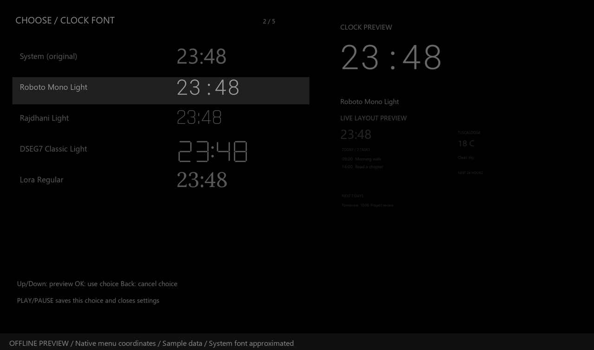

# Sleep Dashboard 2.1.0

## Install and launch

Build with `./package-all.ps1`, then install `dist/sleep-dashboard-roku.zip` through the Roku developer installer and launch **Sleep Dashboard** from Roku Home. A sideload replaces the existing developer-channel package; keeping the old screensaver ZIP files lets you reinstall them. The interactive app and screensaver are separate packages, not combined entry points.

The local app installer includes `source/config.brs`, just like the existing agenda screensaver. If it contains your private Outlook ICS link, **do not share that ZIP**. Git ignores the configuration, generated staging and all installers. A public checkout builds with a blank configuration until its owner supplies their own link.

## Defaults

- Pages: Dashboard, News, Telegram, in that order. Other pages are initially off.
- Dashboard layout: Balanced; medium text; 24-hour clock; date hidden.
- Idle black screen: 300 seconds; optional clock standby is off.
- Night: 23:00 through 06:59 using the Roku local timezone. Equal start/end disables the night interval.
- Colors: gray; daytime #242424, nighttime #0C0C0C. Temporary reading boost is off.
- Rotation: Dashboard 120 seconds; News 60 seconds; Telegram uses per-page reading time.
- Manual navigation pauses rotation; after 180 seconds without another key, automatic rotation resumes if playback is enabled. A five-minute idle timeout can still black the display during a long article: choose a longer timeout or Never if desired.
- Calendar: seven upcoming days and all today's tasks; weather: Tuscaloosa 35406, Celsius.
- Kagi categories: Technology, Science, Economy. Telegram: public DNSPODT, Source article mode on.

## Remote

| Key | Action |
| --- | --- |
| Left / Right | Previous / next enabled page |
| Up / Down | Previous / next story or Telegram reading page; calendar pagination |
| OK | Quick navigation, refresh, black screen, settings |
| Star (`*`) | Settings |
| Play / Pause | Pause / resume automatic rotation |
| Back | Close keyboard/menu, return to settings categories or Dashboard; exit from Dashboard |
| Home / Power | Roku system actions; never remapped |

With Dashboard disabled, Back from a content page exits. In black-screen/clock-standby mode, the first supported remote press only wakes; its release/repeats cannot also turn a page. Home/Power are not app wake keys. Waking does not automatically boost brightness unless you enabled reading boost.

## Settings

Settings have a category rail, option list and live preview. Up/Down selects a category; OK opens it. Inside a category, Left/Right changes values directly; OK opens a complete choice list for longer sets or toggles a two-choice option. In a choice list, Up/Down previews; OK keeps the choice in the draft; Back restores the previous value. Back from a category returns to the category rail.

All changes remain previews until **Save & close** or **Play/Pause** from a settings page. Up above the first item or Down below the last reaches the persistent Save / Discard buttons. Back or Star at the top prompts to save, keep editing or discard when there are unsaved changes. Text entry has its own SAVE key, which updates the draft; still save settings afterward. Idle timeout still cancels unsaved settings/text entry before sleeping. Network/account changes apply only to saved settings.

### Clock

Choose System (original), Roboto Mono Light, Rajdhani Light, DSEG7 Classic Light or Lora Regular. The font picker displays the same time in every font, with a larger live preview on the right. All fonts are bundled static TTFs; no font download or font measurement occurs on the render thread. The serif is an internally renamed static derivative of Lora. See [font sources and licenses](../outlook-screensaver/fonts/README.md).

Minute transition: Off, Fade (default), or Slide. Transitions last 0.24 seconds; Slide moves only eight pixels. The colon does not blink and the animation does not raise text brightness. Choose clock size 90/110/140, 12/24-hour format and date visibility. AM/PM is a separate label so the digital font needs only digits and a colon. Reader pages cap clocks at 110px to preserve article space.

Idle screen: Black screen (default) or Clock only. Clock only hides all other content and relocates to one of nine safe positions every ten minutes from entering standby, even across background refreshes. Movement does not reset the user-idle timer or alter the selected page/article; wake restores the normal layout. Black screen remains entirely black. Position changes mitigate static-image exposure, not a guarantee against image retention.

### Pages

Choose startup page or Last viewed. Select a page and press OK to toggle it; Left/Right changes its position in the ordered list. At least one page must stay enabled. The same ordered enabled list drives remote navigation and automatic rotation. A disabled startup page falls back to the first enabled page.

Dashboard depends on both calendar and weather. A separate disabled Weather page therefore does not stop weather updates if Dashboard is still on. Disabling News or Telegram stops their future requests; a request already in flight may finish but is ignored if its settings no longer match.

### Layout

Balanced is the original day planner/weather split. Agenda Focus widens the agenda and reduces the weather area. Minimal shows the clock, one today's task and current weather; the full list is still available on Agenda. The dedicated Agenda page uses the full text width. News and Telegram keep full-width reading layouts regardless of Dashboard preset.

Choose small/medium/large content text and 90/95/100% content scale for safe margins. Clock options have moved to the Clock category; existing saved values are retained. Minimal also honors the chosen clock size. Restore visual defaults changes only visual options, never account settings. Telegram content-font changes regenerate measured reading pages in its worker before showing the new layout.

### Display

Idle choices: Never, 1/3/5/10/30 minutes or 1 hour. Choose the idle appearance under Clock > Idle screen. Automatic page changes and network refreshes are **not** remote activity and never reset this timer. Both article and agenda pagination stop while sleeping.

**Keep running** remains experimental and Off for new installations; an existing saved On value is retained. Enable it and **Save & close** to opt in. It attempts one ten-second, local, silent black video every 3600 seconds, independently of page rotation and app black screen. It never loops continuously, resets the user-idle clock, changes pages, raises brightness or sends simulated remote keys. A real remote press stops the pulse before normal wake/navigation handling. Saving Off cancels it immediately. A failure waits until the next hourly attempt. Initial testing on the owner's TV exceeded three hours without an idle exit; this is not a universal guarantee. See [the experiment notes](hourly-experiment.md).

Night start/end are local hours. Day and night each have Extra dim, Low and Medium brightness. Gray and Warm gray text tones leave the background opaque black. Optional temporary reading boost raises text brightness only during manual browsing. These controls cannot adjust the television's hardware backlight or guarantee prevention of image retention.

### Rotation

Enable/disable autoplay, choose manual-browse auto-resume (Never / 60 / 180 / 300 seconds), and choose module dwell times of 30/60/90/120/180/300 seconds. Slow/Normal/Fast article speed applies factors 1.5/1/0.75 to measured Telegram reading time. All pages of the same message/article advance consecutively before another module.

### Content and privacy

Calendar range: 1/3/7 upcoming days; today's finished tasks can be hidden. Changing these display filters retains the current tasks until refreshed data arrives; even an identical agenda response is published to the UI again. Only an account change or disconnection clears private rows immediately. Add an HTTPS ICS URL with the masked keyboard, or keep the link bundled in your personal installer. URLs never appear in the settings list or status panel. **Forget Outlook** disables calendar requests, deletes the saved override and clears displayed tasks when you save. It also opts out of the bundled link; it cannot erase a URL compiled into an already-installed package. To remove that bundled secret from the package itself, build a new installer with a blank configuration. A native registry is local storage, not an encrypted password vault.

Weather accepts a city or postal code (five-digit ZIPs are searched in the US); include country/state qualifiers for ambiguous city names, for example `Paris, France`. The provider's first match is used. An unresolved location shows an unavailable/delayed state rather than silently using a different location. Default ZIP 35406 retains the existing approximate coordinates. Fahrenheit is a display conversion from the cached Celsius forecast; it does not contaminate future Celsius readings.

The dashboard and dedicated weather page display only the city name, not the configured postal code. Default 35406 displays TUSCALOOSA immediately; other postal codes use the provider's city name after lookup. Before an unknown postal code is resolved, the heading is simply WEATHER. Unit changes and failed refreshes keep the current city's metadata.

Toggle the three Kagi categories independently; all off means no news requests. Enter a public Telegram channel name, `@name` or `https://t.me/name`. Private/login-only channels are not supported. With Source mode enabled, readable Telegraph articles replace Source-ending captions; unsupported or unavailable sources are skipped. Turning the mode off shows the post's own caption/body instead. Reply previews remain excluded.

### Status

Shows update state for Outlook, weather, news and Telegram. Refresh all or one enabled data source manually. Disabled sources are not forced on by Refresh. Settings saves run on a Task, coalesce pending changes, and retry failed storage writes. Layout previews and keyboard drafts are never written as committed settings.

The status panel also shows hourly pulse state and the previous exit reason if Roku supplied it. **Test hourly playback now** needs a saved On switch. If it is Off or changes are unsaved, confirmation offers **Enable, save and test** or **Save changes and test**; only explicit confirmation commits the draft and enables playback. Keep editing / Back starts nothing. A manual test reschedules the next automatic pulse for one hour later. Playback completion alone is not proof of idle-exit prevention.

## Verification and device limitations

`npm test` checks settings validation, page ordering and last-page protection, data dependencies, night hours, wake-key consumption, cancellation/save semantics, source-generation checks, Telegram-only refresh rotation, Celsius/Fahrenheit conversion and existing screensaver/calendar/news/Telegram behavior. Static guards reject render-thread registry/network/font-metric calls. The app build separately compiles its generated scene and verifies a normal Home-screen manifest/Main entry point.

Desktop tests and offline layout simulations do not replace a Roku device test. After installing, verify remote focus, storage across app relaunch, the chosen idle boundary, a long article across multiple pages, and wake after both app black screen and any Roku system screensaver. Check TV sleep/power-saving settings separately. This app does not keep the hardware awake with simulated keys, run after Home exits it, or guarantee automatic app launch after power-on. The hourly media experiment suppresses the system screensaver only during its short playback; there is no guarantee it resets the separate idle-exit policy.

To regenerate the settings simulations, run `node scripts/settings-preview.cjs`
for the actual mock node tree or `python scripts/render-settings-preview.py`
with Pillow installed. The images use synthetic tasks, the bundled clock fonts
and a Segoe UI approximation for Roku's system font; they are not TV captures.
